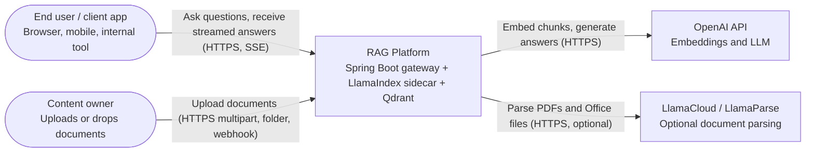
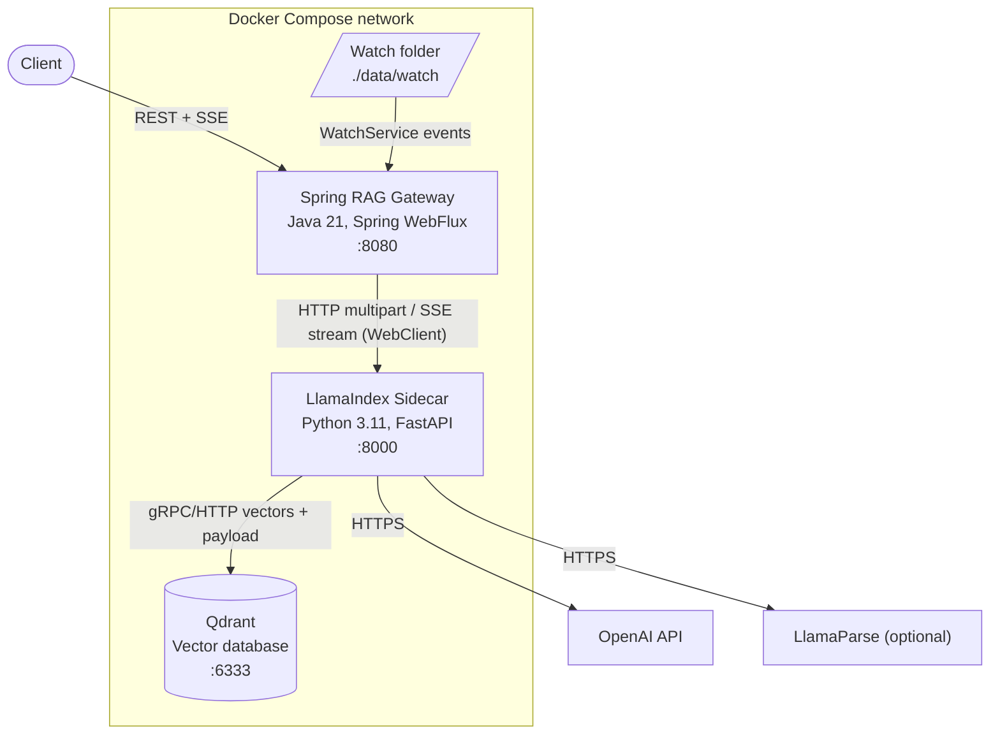
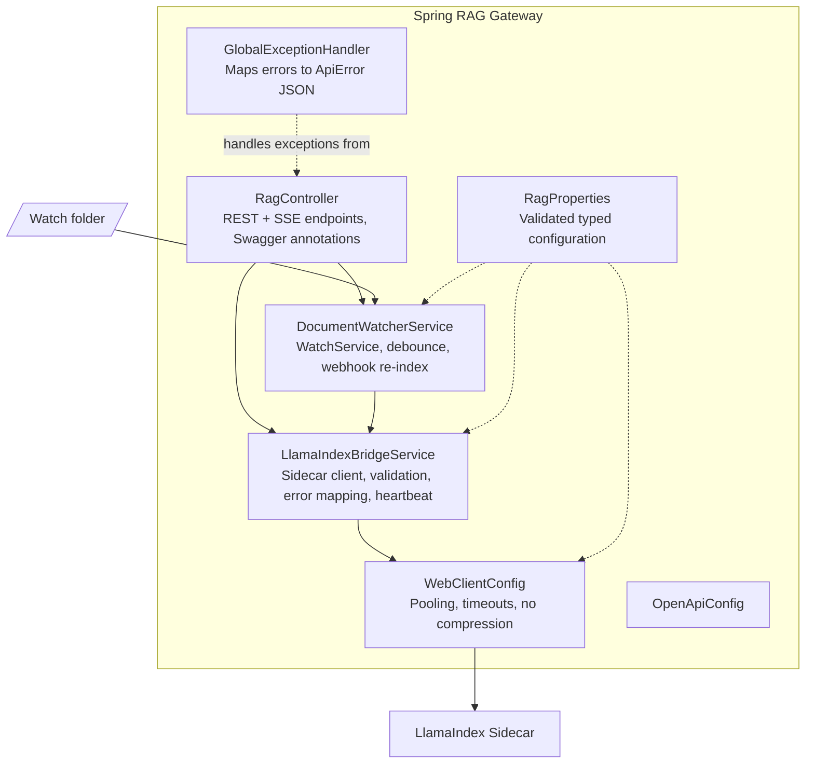
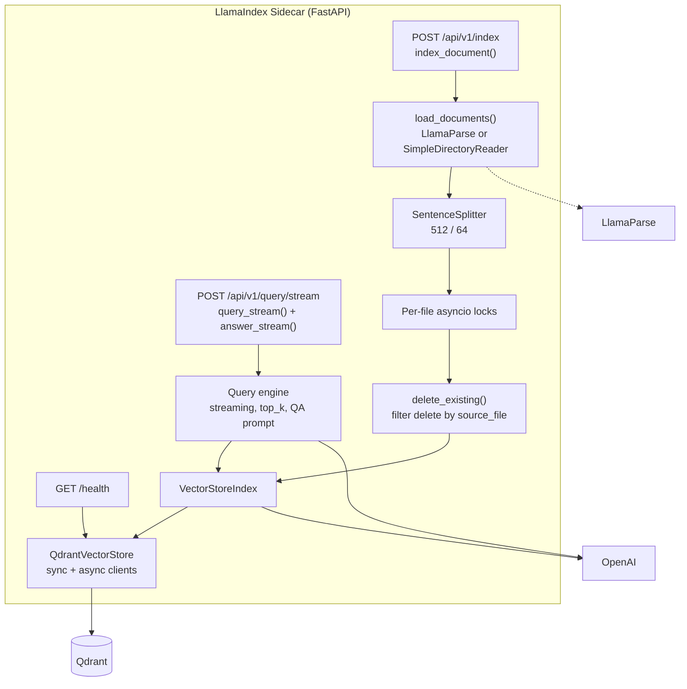
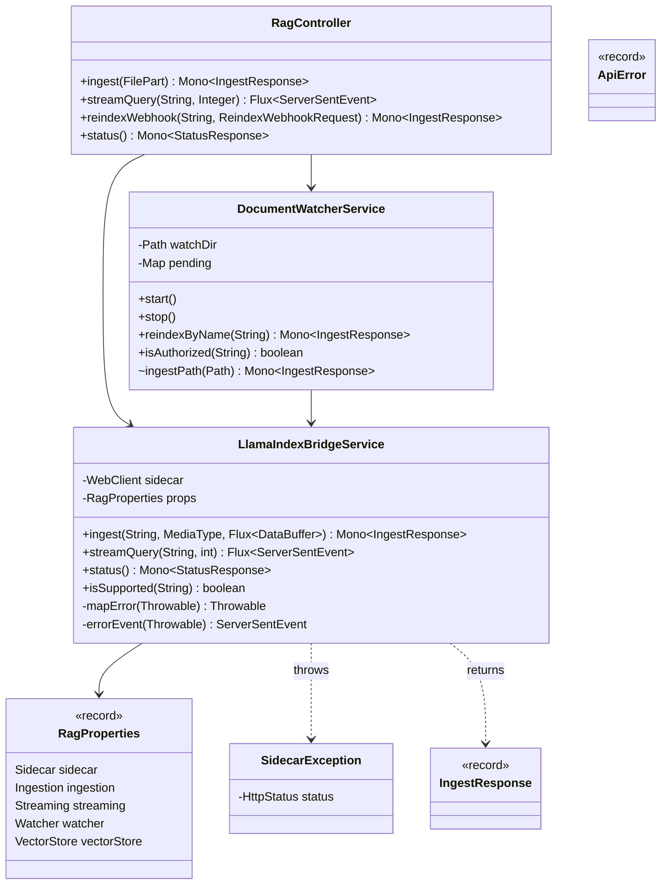
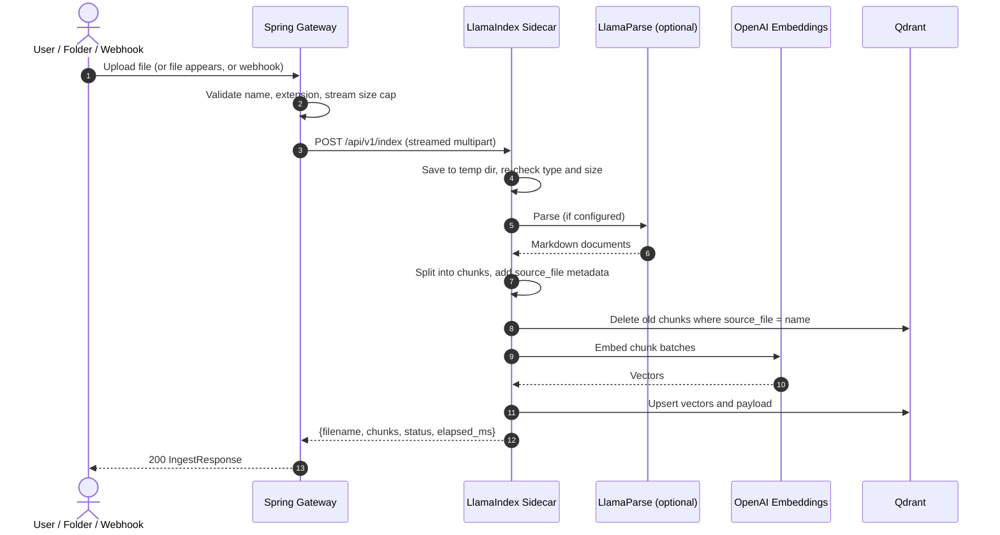
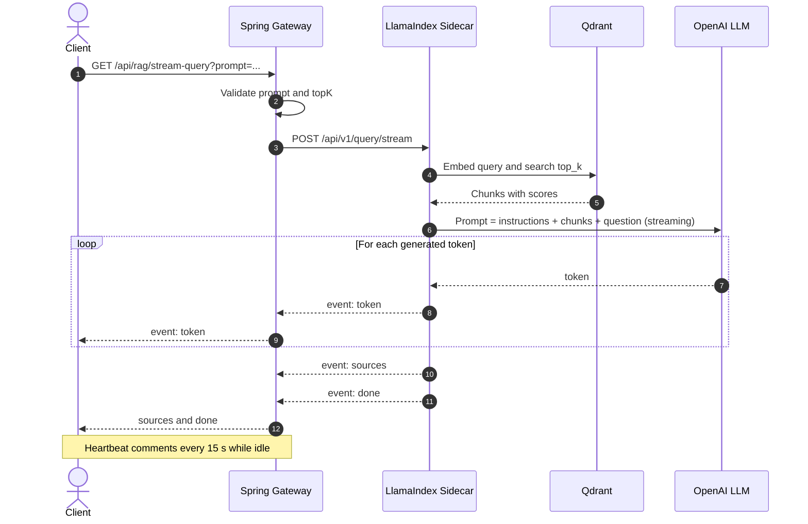

# Spring Boot + LlamaIndex Real-Time RAG Platform

A hybrid Retrieval-Augmented Generation (RAG) system. A **Spring Boot 3 / Java 21** reactive gateway handles REST, Server-Sent Events (SSE), validation and file-watching. A **Python 3.11 FastAPI** sidecar runs **LlamaIndex** for parsing, chunking, embedding, retrieval and streamed answer synthesis over **Qdrant**.

Repository: <https://github.com/coder-stat920715/spring-boot-llamaindex-rag>

---

## Table of Contents

1. [Overview and Features](#1-overview-and-features)
2. [Quick Start](#2-quick-start)
3. [API Reference](#3-api-reference)
4. [High-Level Design (HLD)](#4-high-level-design-hld)
   - [C4 Level 1 - System Context](#41-c4-level-1---system-context)
   - [C4 Level 2 - Containers](#42-c4-level-2---containers)
   - [Container deep dives (6 parameters each)](#43-container-deep-dives-six-parameters-each)
5. [Low-Level Design (LLD)](#5-low-level-design-lld)
   - [C4 Level 3 - Components](#51-c4-level-3---components)
   - [C4 Level 4 - Code](#52-c4-level-4---code)
   - [Contracts, data model, error and timeout tables](#53-contracts-data-model-error-and-timeout-tables)
6. [End-to-End Workflow](#6-end-to-end-workflow)
7. [Why LlamaIndex](#7-why-llamaindex)
8. [LlamaIndex vs LangChain](#8-llamaindex-vs-langchain)
9. [Configuration Reference](#9-configuration-reference)
10. [Testing, Observability and Operations](#10-testing-observability-and-operations)
11. [Known Gaps and Roadmap](#11-known-gaps-and-roadmap)
12. [Troubleshooting](#12-troubleshooting)
13. [Project Structure](#13-project-structure)

> **A note on numbers.** KPIs and performance targets in this document are **design targets** to validate with load tests (k6 / Gatling). They are not measured benchmarks of this repository.

---

## 1. Overview and Features

LLMs do not know your private documents. RAG fixes this by retrieving relevant passages at question time and giving them to the LLM as context. This project packages that pattern as two cooperating services.

| Capability | How it is delivered |
|---|---|
| Real-time indexing | Upload via `POST /api/rag/ingest`, drop a file into the watched folder, or call the reindex webhook. |
| Streaming answers | LlamaIndex streams tokens, the sidecar emits SSE, and the gateway forwards them as `Flux<ServerSentEvent<String>>`. |
| Re-index without duplicates | Chunks carry a `source_file` payload; the previous chunks of a file are deleted before new ones are inserted. |
| Graceful failure | Sidecar errors become a terminal SSE `error` event, so clients never receive a half-broken stream. |
| Backpressure | `limitRate`, non-buffered multipart streaming and an async generator on the Python side. |
| API docs | OpenAPI 3 / Swagger UI via Springdoc. |
| Containerised | Docker Compose runs the gateway, the sidecar and Qdrant. |

**Stack:** Java 21, Spring Boot 3.3.5 (WebFlux), Lombok, Springdoc 2.6, Python 3.11, FastAPI, `llama-index-core` 0.11, `llama-index-vector-stores-qdrant`, LlamaParse (optional), Qdrant v1.12, OpenAI (default LLM and embeddings).

---

## 2. Quick Start

```bash
git clone https://github.com/coder-stat920715/spring-boot-llamaindex-rag.git
cd spring-boot-llamaindex-rag
cp .env.example .env          # set OPENAI_API_KEY (optionally LLAMA_CLOUD_API_KEY, WEBHOOK_SECRET)
docker compose up --build
```

| Endpoint | URL |
|---|---|
| Swagger UI | <http://localhost:8080/swagger-ui.html> |
| Gateway health | <http://localhost:8080/actuator/health> |
| Qdrant dashboard | <http://localhost:6333/dashboard> |

Try it:

```bash
# 1. Index a document
curl -F "file=@handbook.pdf" http://localhost:8080/api/rag/ingest

# 2. Ask a question and watch tokens stream
curl -N "http://localhost:8080/api/rag/stream-query?prompt=What%20is%20the%20refund%20policy&topK=5"

# 3. Real-time indexing: just drop a file in the watched folder
cp policy.md ./data/watch/

# 4. Webhook re-index of a file already in ./data/watch
curl -X POST http://localhost:8080/api/rag/webhook/reindex \
  -H "Content-Type: application/json" -H "X-Webhook-Secret: $WEBHOOK_SECRET" \
  -d '{"filename":"policy.md"}'
```

Local development without Docker for the gateway: start Qdrant and the sidecar (`uvicorn main:app --port 8000` inside `llama-service/` after `pip install -r requirements.txt`), then run `mvn spring-boot:run` inside `spring-rag-service/`.

---

## 3. API Reference

### Gateway (`:8080`)

| Method and path | Purpose | Success | Errors |
|---|---|---|---|
| `POST /api/rag/ingest` (multipart `file`) | Index or re-index one document | `200 IngestResponse` | 400 bad name, 413 too large, 415 type, 502/503/504 sidecar |
| `GET /api/rag/stream-query?prompt=&topK=` | Stream an answer (SSE) | `200 text/event-stream` | 400 validation (prompt 1-4000 chars, topK 1-20) |
| `POST /api/rag/webhook/reindex` | Re-index a file in the watch directory | `200 IngestResponse` | 401 bad secret, 404 missing, 400 path traversal |
| `GET /api/rag/status` | Sidecar health and vector store info | `200 StatusResponse` | n/a (reports `UNAVAILABLE`) |

**SSE event contract** (the `data:` payload is always JSON):

| Event | Payload | Meaning |
|---|---|---|
| `token` | `{"token":"..."}` | One streamed LLM fragment |
| `sources` | `{"sources":[{"file":"a.pdf","score":0.83}]}` | Retrieved chunks used for the answer |
| `done` | `{}` | Normal completion |
| `error` | `{"code":"...","message":"..."}` | Terminal failure (`NO_DOCUMENTS`, `QUERY_FAILED`, `UPSTREAM_ERROR`) |
| comment `: keep-alive` | none | Heartbeat every 15 s to keep proxies from closing idle connections |

Browser example:

```javascript
const es = new EventSource("/api/rag/stream-query?prompt=" + encodeURIComponent(q));
es.addEventListener("token",   e => output.textContent += JSON.parse(e.data).token);
es.addEventListener("sources", e => showSources(JSON.parse(e.data).sources));
es.addEventListener("error",   e => { if (e.data) showError(JSON.parse(e.data).message); es.close(); });
es.addEventListener("done",    () => es.close());
```

### Sidecar (`:8000`, internal only)

| Method and path | Purpose |
|---|---|
| `POST /api/v1/index` (multipart `file`) | Parse, chunk, embed and upsert a document |
| `POST /api/v1/query/stream` (`{"prompt","top_k"}`) | Retrieve and stream an answer as SSE |
| `GET /health` | Qdrant connectivity check (`UP` / 503 `DOWN`) |

---

## 4. High-Level Design (HLD)

### 4.0 Goals, constraints and principles

| Item | Decision |
|---|---|
| Goal | Answer questions over private documents with citations, new documents searchable within seconds, tokens visible as they are generated. |
| Non-goals | Multi-tenant SaaS, fine-tuning, agentic tool use (see roadmap). |
| Why two services | Java gives enterprise-grade HTTP, validation and operations. Python is where LlamaIndex, parsers and the ML ecosystem live. A sidecar keeps each language doing what it is best at. |
| Why reactive | An SSE answer holds a connection open for seconds. A non-blocking stack serves many such connections on few threads. |
| Principles | Stateless services, state only in Qdrant. Fail soft on the streaming path. Validate at the edge. Configuration through environment variables. |

### 4.1 C4 Level 1 - System Context

*Who uses the system and what it depends on.*



### 4.2 C4 Level 2 - Containers

*Deployable units and how they talk.*



| Container | Responsibility in one line |
|---|---|
| Spring RAG Gateway | Public API, validation, streaming relay, file watching, error shaping. |
| LlamaIndex Sidecar | The RAG engine: parse, chunk, embed, store, retrieve, synthesise, stream. |
| Qdrant | Durable vector index with metadata filtering. |
| OpenAI / LlamaParse | External model and parsing services. |

### 4.3 Container deep dives (six parameters each)

#### 4.3.1 Spring RAG Gateway (`spring-rag-service/`)

**1. Primary purpose and key responsibilities**
- Single public entry point for clients. Hides the Python sidecar, Qdrant and the LLM provider behind a stable API.
- Validates every request: prompt length, `topK` range, file name sanitisation, extension allow-list, upload size cap.
- Streams uploads to the sidecar without loading whole files into memory.
- Relays SSE tokens with backpressure (`limitRate`), idle timeouts, heartbeats and bounded retry on connection errors.
- Converts any upstream failure into a well-formed HTTP error or an SSE `error` event.
- Watches a folder and exposes a webhook so indexing happens automatically when documents change.

**2. Measuring success (KPIs)**

| KPI | Target |
|---|---|
| Gateway added latency (p95, excluding sidecar) | < 30 ms |
| Time to first SSE byte after sidecar's first token | < 20 ms |
| Availability of the gateway | >= 99.9 % monthly |
| Request-level error rate (5xx, excluding upstream 502/503/504) | < 0.1 % |
| Watcher event-to-indexed lag for a 1 MB text file | < 5 s |
| Stream completion ratio (`done` events / started streams) | > 98 % |

**3. Data flow, response times and failure impact**
- **In:** multipart files, query strings, webhook JSON. **Out:** JSON responses and SSE frames. **Downstream:** sidecar only.
- **Typical times:** validation and routing is a few milliseconds. Ingest and query time is dominated by the sidecar. Streams are bounded by the 60 s idle timeout, and non-stream calls by the 180 s response timeout.
- **If the gateway fails:** all clients lose access, but no data is lost (state is in Qdrant), and a restart is stateless. In-flight streams are cut and clients must retry.
- **If the sidecar fails:** ingest returns 502/503/504 with a JSON `ApiError`. Queries receive an SSE `error` event. Health reports `UNAVAILABLE`.

**4. Technologies, advantages and limitations**

| Technology | Advantage | Limitation |
|---|---|---|
| Java 21 | Mature tooling, strong typing, records for DTOs | Heavier image and slower cold start than Python or Go |
| Spring WebFlux / Reactor Netty | Many concurrent SSE streams on few threads, native backpressure | Reactive code is harder to debug, and blocking calls must be kept off event-loop threads |
| WebClient | Streaming multipart and SSE, timeouts, connection pooling | No built-in circuit breaker (Resilience4j is on the roadmap) |
| Springdoc OpenAPI | Always-current Swagger UI | Multipart schemas sometimes need manual tuning |
| `WatchService` | Zero extra infrastructure for file triggers | Not cluster-safe (see scalability) and unreliable on some network filesystems |

**5. Scalability and performance targets**
- Stateless apart from the in-process watcher, so it scales horizontally behind a load balancer. SSE needs no sticky sessions because each stream is one HTTP request.
- Target: >= 500 concurrent SSE streams per 1 vCPU / 1 GB instance (open connections are cheap on Netty). Connection pool capped at 100 sidecar connections (`rag.sidecar.max-connections`).
- When running more than one replica, enable the watcher on exactly one (`WATCH_ENABLED=false` on the others), otherwise the same file is indexed several times.
- Load balancers must allow idle timeouts above the 15 s heartbeat and must disable response buffering for `/api/rag/stream-query`.

**6. Security, reliability and compliance**
- **Implemented:** input validation and file-name sanitisation (path components stripped, characters whitelisted), extension allow-list, size cap enforced while streaming, path-traversal guard in the webhook, constant-time webhook secret comparison, non-root container user, no stack traces in responses, graceful shutdown.
- **Reliability:** timeouts at connect, response and per-element level, bounded retry only before the first byte, error-as-event for streams.
- **Not yet implemented (required before public exposure):** authentication and authorisation (Spring Security with OAuth2/JWT), rate limiting per client, TLS termination (use an ingress or reverse proxy), CORS policy, audit logging, antivirus scanning of uploads.
- **Compliance notes:** logs contain prompt length, not prompt text, which reduces the chance of leaking personal data. If documents contain personal data, apply GDPR/DPDP-style retention, deletion and access controls on the watch folder and Qdrant (a delete-by-file API is on the roadmap).

#### 4.3.2 LlamaIndex Sidecar (`llama-service/`)

**1. Primary purpose and key responsibilities**
- Own the whole RAG pipeline: **load** (LlamaParse or `SimpleDirectoryReader`), **chunk** (`SentenceSplitter`, 512 tokens / 64 overlap), **embed** (OpenAI embeddings), **store** (Qdrant), **retrieve** (top-k similarity), **synthesise** (LLM with a grounded prompt) and **stream** (async token generator).
- Guarantee idempotent re-indexing: delete old chunks by `source_file`, then insert new ones, under a per-file lock.
- Return source attribution (file and score) after the answer.
- Expose a `/health` probe that checks Qdrant connectivity.

**2. Measuring success (KPIs)**

| KPI | Target |
|---|---|
| Time to first token (p95) | < 2.5 s |
| Ingest latency, 10-page text PDF (p95) | < 15 s |
| Retrieval hit rate on a labelled question set | > 85 % |
| Faithfulness (answers supported by retrieved context, via LlamaIndex evaluators or human review) | > 90 % |
| "I do not know" correctness on out-of-corpus questions | > 90 % |
| Embedding/LLM API error rate | < 1 % |

**3. Data flow, response times and failure impact**
- **Ingest path:** upload -> temp file -> parse -> nodes -> delete old chunks -> embed in batches -> upsert to Qdrant -> JSON result. Time is dominated by parsing and embedding API calls.
- **Query path:** prompt -> embed query -> Qdrant search -> build prompt -> LLM streaming -> SSE. Embedding and search typically take hundreds of milliseconds. The first token arrives after LLM time-to-first-token.
- **If it fails:** no new indexing or answers, but existing vectors remain safe. Errors reach clients as 4xx/5xx or SSE `error`.
- **If OpenAI is down:** both embedding (ingest and query) and generation fail. Qdrant data stays intact. Consider a secondary provider (LlamaIndex makes swapping LLMs a settings change).
- **If LlamaParse is down:** parser-only formats fail with 422. Plain `txt`, `md` and `pdf` fall back to local readers only when no LlamaParse key is configured, so configure it deliberately.

**4. Technologies, advantages and limitations**

| Technology | Advantage | Limitation |
|---|---|---|
| LlamaIndex 0.11 | Purpose-built for ingestion, indexing and retrieval, so the pipeline is a few lines | Fast-moving API, so versions must be pinned |
| FastAPI + uvicorn | Async I/O, automatic validation, `StreamingResponse` for SSE | Single worker by default, and CPU-bound parsing blocks that worker unless offloaded (the code uses `asyncio.to_thread`) |
| LlamaParse | Strong layout, table and scanned-document handling | Paid cloud service, and documents leave your network |
| OpenAI | High quality, simple API | Cost per token, data-residency concerns, rate limits |
| Pydantic | Strict request models | n/a |

**5. Scalability and performance targets**
- CPU is mostly idle waiting on remote APIs, so a single worker handles dozens of concurrent streams. Scale out with replicas, or raise uvicorn `--workers` (each worker holds its own clients and locks).
- Target: 50 concurrent streaming queries and 5 concurrent ingests per replica. Embedding calls are batched by LlamaIndex.
- **Caveat:** the per-file lock is in-process. With several replicas, two replicas re-indexing the same file concurrently could interleave delete and insert. Mitigate by routing on file name (consistent hashing at the load balancer), a distributed lock (Redis), or deterministic point IDs.
- Control cost with `top_k`, chunk size and a cheaper `LLM_MODEL`.

**6. Security, reliability and compliance**
- **Implemented:** extension allow-list, upload size cap, file-name sanitisation, temp directory cleaned in `finally`, non-root container, no secrets in the image (all via environment), sidecar not published outside the Compose network.
- **Prompt-injection posture:** the QA prompt tells the model to answer only from context, but retrieved documents are untrusted input. Treat documents as data, restrict who can upload, and keep the LLM free of tool access.
- **Data protection:** document text is sent to OpenAI (and LlamaParse if enabled). For regulated data use a private or on-prem model through LlamaIndex's LLM interface, and sign the relevant DPAs.
- **Reliability:** failures inside the generator are converted to an SSE `error` event. Client disconnects raise `CancelledError`, which stops generation and saves tokens.
- **Missing for production:** mutual authentication between gateway and sidecar (service mesh or API token), request-size limits at the proxy, structured trace IDs.

#### 4.3.3 Qdrant Vector Database

**1. Primary purpose and key responsibilities**
- Persist chunk embeddings (1536 dimensions for `text-embedding-3-small`) and payload (`source_file`, node content, `doc_id`).
- Serve approximate nearest-neighbour search (HNSW) with cosine similarity.
- Support filter-based deletion (used for re-indexing by `source_file`).

**2. Measuring success (KPIs)**

| KPI | Target |
|---|---|
| Search latency p95 at 1 M vectors | < 50 ms |
| Recall@10 against exact search | > 95 % |
| Availability | >= 99.9 % |
| Snapshot/backup success | 100 % daily |

**3. Data flow, response times and failure impact**
- **In:** upserts and deletes from the sidecar. **Out:** top-k hits with payload.
- **Failure impact:** queries return `NO_DOCUMENTS` or `QUERY_FAILED`, ingestion fails, and `/health` reports DOWN, so Compose will not start dependents until it is healthy. Data survives restarts through the `qdrant_data` volume.

**4. Technologies, advantages and limitations**

| Aspect | Advantage | Limitation |
|---|---|---|
| Rust engine | Fast and memory efficient, with payload filtering | Single-node in this Compose setup, so it is a single point of failure |
| HNSW index | Millisecond search | Approximate, not exact. Memory grows with vector count (1 M x 1536 x 4 B is about 6 GB raw, before index overhead) |
| Alternatives | PgVector suits teams already on PostgreSQL | PgVector needs sidecar wiring changes (see roadmap) |

**5. Scalability and performance targets**
- Vertical scaling first. For large corpora enable scalar or binary quantisation, on-disk vectors, sharding and replication (Qdrant cluster mode or Qdrant Cloud).
- Target: 10 M chunks per cluster with quantisation, 200 queries per second per node.

**6. Security, reliability and compliance**
- Set `QDRANT_API_KEY` (the sidecar already reads it) and enable TLS. **Remove the `6333:6333` host port mapping in production.**
- Back up with Qdrant snapshots to object storage. Encrypt volumes at rest.
- Deleting a user's data means deleting by `source_file` (or a future `tenant_id` payload).

#### 4.3.4 External: OpenAI API (embeddings and LLM)

| Parameter | Detail |
|---|---|
| **1. Purpose** | Turn text into vectors (`text-embedding-3-small`) and generate grounded answers (`gpt-4o-mini` by default). Both models are changeable through `EMBED_MODEL` and `LLM_MODEL`. |
| **2. KPIs** | Time to first token < 1.5 s, error rate < 1 %, cost per answered question (tracked monthly), token usage per query. |
| **3. Data flow and failure** | Receives chunk text (ingest) and prompt plus retrieved context (query). If unavailable, indexing and answering stop, and Qdrant data is unaffected. Rate-limit (429) errors surface as `QUERY_FAILED`. |
| **4. Tech, pros, cons** | Strong quality and easy API. Cons: vendor lock-in of embedding space (changing embedding model requires re-indexing everything), cost, external data processing. |
| **5. Scale and targets** | Governed by account rate limits. Add retry with backoff, queueing for bulk ingest, and optionally a response cache. |
| **6. Security and compliance** | Key held only in the sidecar environment. Review the provider's data-retention and zero-data-retention options, and your regional data rules. |

#### 4.3.5 External: LlamaParse / LlamaCloud (optional)

| Parameter | Detail |
|---|---|
| **1. Purpose** | High-fidelity parsing of PDFs, Office files, tables and scans into clean Markdown before chunking. Enabled only when `LLAMA_CLOUD_API_KEY` is set. |
| **2. KPIs** | Parse success rate > 99 %, table-preservation quality on a sample set, parse time per page. |
| **3. Data flow and failure** | Sidecar uploads the file and receives Markdown documents. On failure the sidecar returns 422 and nothing is indexed for that file. |
| **4. Tech, pros, cons** | Much better than plain text extraction for complex layouts. Cons: paid, adds latency, documents leave your environment. |
| **5. Scale and targets** | Parse in parallel per file, and pre-parse large batches offline. |
| **6. Security and compliance** | Do not enable for confidential documents unless the vendor's terms satisfy your policy. Leave the key empty to stay fully local (limited to `txt`, `md`, `pdf`). |

---

## 5. Low-Level Design (LLD)

### 5.1 C4 Level 3 - Components

#### Spring RAG Gateway components



| Component | Responsibility | Key design decisions |
|---|---|---|
| `RagController` | Defines endpoints, binds and validates parameters | Constraint annotations on parameters give 400s automatically. Controller stays thin and returns `Mono` / `Flux`. |
| `GlobalExceptionHandler` | Uniform `ApiError` for `SidecarException`, `ResponseStatusException`, validation, buffer limits and unknown errors | Never leaks stack traces. Full detail is logged server side. |
| `LlamaIndexBridgeService` | Builds streaming multipart, calls sidecar, enforces size and type, maps errors, merges heartbeat | `Flux.defer` gives a fresh byte counter per subscription. `publish` shares the stream so heartbeats stop when the stream ends. Retry only on `WebClientRequestException` so tokens are never replayed. |
| `DocumentWatcherService` | Observes the directory, debounces bursts (1.5 s), reads files as `Flux<DataBuffer>`, handles webhook auth and path safety | Blocking file checks are moved to `boundedElastic`. Unsupported extensions (editor temp files) are ignored. |
| `WebClientConfig` | One tuned `WebClient` and `ConnectionProvider` | `compress(false)` prevents SSE buffering. Idle eviction and pending-acquire timeout protect the pool. |
| `RagProperties` | `@ConfigurationProperties` records with Bean Validation | The app fails fast at startup on bad configuration. |

#### LlamaIndex sidecar components



| Component | Responsibility | Key design decisions |
|---|---|---|
| `index_document` | Receive upload, validate, write to temp dir in 1 MB chunks, orchestrate pipeline | Size cap checked while reading. Temp dir always removed. 422 for unparsable or empty text. |
| `load_documents` | Choose parser | LlamaParse when configured (`aload_data`), otherwise local reader in a worker thread. |
| `SentenceSplitter` | Sentence-aware chunking | 512 tokens with 64 overlap preserves context across boundaries. |
| `delete_existing` + locks | Make re-indexing idempotent | Delete and insert happen under one lock per file name. |
| `answer_stream` | Async generator producing SSE text | Emits `token`, `sources`, `done`. Converts exceptions to `error`. Re-raises `CancelledError` so cancelled clients stop token generation. |
| `/health` | Liveness and dependency check | Returns 503 when Qdrant is unreachable. |

### 5.2 C4 Level 4 - Code

#### Gateway class diagram



#### Key algorithms

**Streaming with heartbeat (gateway).** The upstream flux is shared so the heartbeat can stop the moment the answer ends:

```java
return upstream.publish(shared ->
        Flux.merge(shared, heartbeat.takeUntilOther(shared.ignoreElements())));
```

**Idempotent re-index (sidecar):**

```python
async with state.locks[name]:
    await asyncio.to_thread(delete_existing, state.client, name)   # filter delete on source_file
    await asyncio.to_thread(state.index.insert_nodes, nodes)       # embed + upsert
```

**Debounced watcher (gateway):** each file system event cancels the pending task for that path and schedules a new one 1.5 s later, so a file written in many bursts is indexed once.

### 5.3 Contracts, data model, error and timeout tables

**Qdrant point (one chunk):**

| Field | Example | Purpose |
|---|---|---|
| id | UUID | Point identifier |
| vector | 1536 floats | Cosine similarity search |
| payload.`source_file` | `handbook.pdf` | Re-index and delete by file, source attribution |
| payload.`_node_content` | JSON with chunk text and metadata | Context passed to the LLM |
| payload.`doc_id`, `ref_doc_id` | UUIDs | LlamaIndex bookkeeping |

**Error mapping (gateway):**

| Condition | HTTP status |
|---|---|
| Bad file name, validation failure, path traversal | 400 |
| Invalid webhook secret | 401 |
| File not found in watch dir | 404 |
| Upload above `max-file-bytes` | 413 |
| Extension not allowed (gateway or sidecar) | 415 |
| Sidecar 4xx (e.g. 422 unparsable) | passed through |
| Sidecar 5xx | 502 |
| Sidecar unreachable | 503 |
| Sidecar timeout | 504 |
| Anything else | 500 |

For `stream-query`, upstream failures after the response has begun become an SSE `error` event instead.

**Timeouts and limits:**

| Setting | Default | Applies to |
|---|---|---|
| `rag.sidecar.connect-timeout` | 5 s | TCP connect |
| `rag.sidecar.response-timeout` | 180 s | Ingest and non-stream calls |
| `rag.streaming.idle-timeout` | 60 s | Max gap between SSE items |
| `rag.streaming.heartbeat` | 15 s | Keep-alive comment |
| `rag.streaming.prefetch` | 16 | `limitRate` upstream demand |
| `rag.ingestion.max-file-bytes` | 50 MB | Upload cap (gateway and sidecar) |
| `MAX_UPLOAD_MB` (sidecar) | 50 | Upload cap |

---

## 6. End-to-End Workflow

### 6.1 Document ingestion



1. A document arrives through one of three triggers: HTTP upload, a file landing in `./data/watch`, or the webhook.
2. The gateway validates and sanitises the name, checks the extension, and counts bytes as they stream.
3. The file is forwarded to the sidecar as multipart without being held in memory.
4. The sidecar writes it to a temp directory, parses it, and splits it into sentence-aware chunks.
5. Existing chunks for the same file are deleted, which prevents stale or duplicate answers.
6. Chunks are embedded and stored in Qdrant, and the new content is searchable immediately.
7. The gateway returns the chunk count and elapsed time.

### 6.2 Streaming question answering



1. The client opens an SSE connection (`EventSource` or `curl -N`).
2. The gateway validates the request and calls the sidecar.
3. LlamaIndex embeds the query and retrieves the top-k chunks from Qdrant.
4. The chunks and question are placed into the grounded QA prompt, and the LLM streams tokens.
5. Each token flows sidecar -> gateway -> client with backpressure and without buffering.
6. After the last token, the sidecar emits `sources` and `done`.
7. If the client disconnects, cancellation propagates through the gateway to the sidecar and the generation stops.
8. If anything fails, the client receives a final `error` event.

---

## 7. Why LlamaIndex

### 7.1 The problem it solves

A raw LLM has three weaknesses for daily work: it does not know your private data, its knowledge is frozen at training time, and it can state wrong things confidently. Pasting documents into the prompt fails once the data is larger than the context window, is expensive on every call, and is slow.

**LlamaIndex** is a data framework for connecting LLMs to your data. It standardises the steps you would otherwise hand-build: **load -> parse -> chunk -> embed -> index -> retrieve -> rank -> synthesise -> evaluate**.

### 7.2 Core concepts (as used in this project)

| Concept | Meaning | Where it appears here |
|---|---|---|
| Document / Node | A source file, and its chunks with metadata and relationships | `Document`, `SentenceSplitter` output in `main.py` |
| Reader / Parser | Turns files and sources into text | `SimpleDirectoryReader`, `LlamaParse` |
| Embedding model | Converts text into vectors | `OpenAIEmbedding` |
| Vector store | Persistent vector index | `QdrantVectorStore` |
| Index | Structure over nodes | `VectorStoreIndex.from_vector_store` |
| Retriever | Finds relevant nodes | Implicit in `as_query_engine(similarity_top_k=...)` |
| Response synthesiser | Builds the final answer from retrieved nodes | Streaming mode with a custom `PromptTemplate` |
| Query engine | Retrieval + synthesis behind one call | `engine.aquery(prompt)` then `async_response_gen()` |

### 7.3 How it accelerates daily tasks

| Daily task | Without LlamaIndex | With LlamaIndex |
|---|---|---|
| Finding a policy clause in 300 PDFs | Manual search, guessing keywords | Ask in plain language, get the passage and source file |
| Onboarding a new engineer | Reading wikis for days | Q&A over wiki, runbooks and past tickets |
| Support agent answering tickets | Searching several tools | Answers grounded in the knowledge base with citations |
| Data-team question about reports | Opening and reading each report | Natural-language queries across reports and tables |
| Building a prototype | Weeks of glue code for chunking, embedding, storage | A working pipeline in under 100 lines (this sidecar is one file) |
| Switching LLM or vector DB | Rewrite integrations | Change one setting or one class (Qdrant -> other stores, OpenAI -> other LLMs) |

The speed-up comes from three things: **less plumbing code** (hundreds of connectors and stores), **better answers per token** (retrieve only what matters instead of sending everything), and **built-in evaluation and observability hooks** so quality can be measured and improved.

### 7.4 Where LlamaIndex performs well

- Question answering over **large private document collections** (PDF, Office, HTML, wikis, databases).
- **Complex document understanding**: tables, multi-column layouts and scans (LlamaParse).
- **Advanced retrieval**: hybrid (keyword + vector) search, metadata filters, re-ranking, auto-merging and hierarchical retrieval, sub-question and router query engines for multi-document questions.
- **Structured extraction** from documents into typed schemas.
- **Agentic RAG**: agents that choose between query engines (one per data source) and tools, and event-driven *Workflows* for multi-step pipelines.
- **Fast iteration**: swap chunking, embeddings, retrievers and LLMs and re-evaluate.

It is less of a fit when the task is mostly chat orchestration with many non-retrieval tools and no document corpus, or when you only need a single prompt call.

### 7.5 Real-life use cases

| Domain | Use case |
|---|---|
| Customer support | Help-centre and ticket-history assistant that cites articles. |
| Legal and compliance | Contract clause search, policy comparison, due-diligence review. |
| Finance | Q&A over earnings reports, filings and research notes, with table understanding. |
| Healthcare and life sciences | Literature and clinical-guideline search (with strict human review and privacy controls). |
| Enterprise knowledge | Internal search across Confluence, SharePoint, Slack, Google Drive and email. |
| Software engineering | Chat over codebases, API docs, runbooks and incident post-mortems. |
| HR and IT | Policy and benefits assistant, IT helpdesk deflection. |
| Education | Course-material tutor answering from the syllabus and textbooks. |
| Sales and procurement | RFP answering from past proposals, vendor-document comparison. |
| Data and operations | Document-to-structured-data extraction (invoices, forms), report summarisation. |

### 7.6 Why it was chosen for this project

1. The core need is **retrieval quality and ingestion**, which is LlamaIndex's focus.
2. **Streaming query engines** map directly to the SSE requirement.
3. First-class **Qdrant** and **LlamaParse** integrations avoid custom code.
4. It keeps the Python surface small (one file), leaving orchestration, security and operations to Spring Boot.

---

## 8. LlamaIndex vs LangChain

Both are open-source frameworks for LLM applications and are often used together. They differ in emphasis. Both evolve quickly, so verify details against current docs.

| Dimension | LlamaIndex | LangChain |
|---|---|---|
| Core focus | **Data**: ingestion, indexing, retrieval and RAG quality | **Orchestration**: chains, tools, agents and integrations |
| Mental model | Documents -> nodes -> index -> retriever -> query engine | Prompts, models, tools and runnables composed into chains and graphs |
| RAG out of the box | Very strong: many index types, retrievers, rerankers, synthesisers, document parsers | Supported through retrievers and loaders, with more assembly |
| Document parsing | LlamaParse and many data connectors (LlamaHub) | Many document loaders |
| Agents and multi-step logic | Agents and event-driven Workflows, usually built around query engines as tools | LangGraph for stateful, controllable agent graphs, a major strength |
| Observability and evaluation | Built-in evaluators and callback integrations | LangSmith for tracing, datasets and evaluation |
| Learning curve for RAG | Lower: a working RAG app in a few lines | Lower for general chains, more concepts for RAG tuning |
| Best fit | Knowledge-heavy apps where retrieval accuracy is the product | Applications dominated by tool use, workflows and integrations |
| Typical combination | Use as the retrieval engine | Use as the orchestrator that calls the LlamaIndex engine as a tool |

**Rule of thumb.** If your difficulty is *getting the right information out of lots of documents*, start with LlamaIndex. If it is *coordinating many tools, models and steps*, start with LangChain/LangGraph. Many production systems use both.

---

## 9. Configuration Reference

### Environment variables

| Variable | Service | Default | Description |
|---|---|---|---|
| `OPENAI_API_KEY` | sidecar | required | OpenAI credentials |
| `LLAMA_CLOUD_API_KEY` | sidecar | empty | Enables LlamaParse and extra file types |
| `QDRANT_URL` | sidecar | `http://localhost:6333` | Qdrant endpoint |
| `QDRANT_API_KEY` | sidecar | empty | Qdrant auth |
| `QDRANT_COLLECTION` | sidecar | `documents` | Collection name |
| `LLM_MODEL` | sidecar | `gpt-4o-mini` | Answer model |
| `EMBED_MODEL` | sidecar | `text-embedding-3-small` | Embedding model (changing it requires re-indexing) |
| `CHUNK_SIZE` / `CHUNK_OVERLAP` | sidecar | `512` / `64` | Chunking |
| `MAX_UPLOAD_MB` | sidecar | `50` | Upload cap |
| `LOG_LEVEL` | sidecar | `INFO` | Log level |
| `SIDECAR_URL` | gateway | `http://localhost:8000` | Sidecar address |
| `WATCH_ENABLED` / `WATCH_DIR` | gateway | `true` / `./data/watch` | File watcher |
| `WEBHOOK_SECRET` | gateway | empty (disabled) | Shared secret for the webhook |
| `QDRANT_HOST` / `QDRANT_PORT` | gateway | `localhost` / `6333` | Reported in `/status` only |

Everything else lives in `spring-rag-service/src/main/resources/application.yml` under the `rag:` prefix.

---

## 10. Testing, Observability and Operations

- **Unit tests:** `mvn test` runs `LlamaIndexBridgeServiceTest` (stream error-as-event, unsupported extension rejection).
- **Suggested additions:** WireMock or MockWebServer tests of SSE relay, Testcontainers (Qdrant) integration tests for the sidecar, `pytest` with a fake embedding model, and k6 scripts for stream concurrency.
- **Logging:** gateway logs key=value lines via SLF4J, the sidecar logs JSON lines. Prompt text is not logged.
- **Metrics and health:** `/actuator/health` (with liveness/readiness probes), `/actuator/metrics`, sidecar `/health`. Recommended additions: Micrometer + Prometheus registry, OpenTelemetry tracing across both services.
- **Dashboards and alerts to create:** p95 time to first token, SSE `error` event rate, ingest failures, Qdrant latency and memory, OpenAI 429 rate and spend.
- **Backups:** Qdrant snapshots on a schedule, and keep source documents in durable storage so the index can be rebuilt.

---

## 11. Known Gaps and Roadmap

| Gap (current state) | Planned improvement |
|---|---|
| No authentication on gateway endpoints | Spring Security with OAuth2/JWT, per-client rate limiting |
| Watcher is not cluster-safe | Leader election, or move to object-storage events (S3/MinIO) with a queue |
| Per-file lock is in-process | Redis lock or deterministic point IDs |
| No circuit breaker | Resilience4j on `WebClient` calls |
| PgVector not wired | Vector-store switch in `lifespan()` behind `VECTOR_STORE_TYPE` |
| No delete-document or list-documents API | `DELETE /api/rag/documents/{name}` and a listing endpoint |
| Single-tenant | `tenant_id` payload and filtered retrieval |
| Retrieval is plain top-k | Hybrid search, re-ranking, query rewriting, metadata filters |
| No automated evaluation | LlamaIndex evaluators in CI against a golden question set |
| Conversation memory absent | Chat engine with session memory |
| Qdrant port published to host | Remove in production, add TLS and API key |

---

## 12. Troubleshooting

| Symptom | Likely cause and fix |
|---|---|
| Sidecar exits with `OPENAI_API_KEY is not set` | Create `.env` from `.env.example` and set the key. |
| `error` event `NO_DOCUMENTS` | Nothing has been indexed yet. Upload a document first. |
| 415 on upload | Extension not allowed. Without `LLAMA_CLOUD_API_KEY` the sidecar accepts only `txt`, `md`, `pdf`. |
| 422 on upload | Document has no extractable text (scanned PDF without OCR) or parsing failed. Use LlamaParse. |
| 503 from gateway | Sidecar unreachable. Check `docker compose ps` and `docker compose logs llama-service`. |
| Tokens arrive all at once | A proxy is buffering. Disable buffering (for nginx: `proxy_buffering off;`) and keep compression off for SSE. |
| Watcher does not fire in Docker on Mac/Windows | Bind-mount file events can be unreliable on those hosts. Use the webhook or upload endpoint. |
| Duplicate indexing with multiple gateway replicas | Set `WATCH_ENABLED=false` on all but one. |
| Dimension mismatch errors after changing `EMBED_MODEL` | Different vector size. Delete the Qdrant collection and re-index. |

---

## 13. Project Structure

```
spring-boot-llamaindex-rag/
├── docker-compose.yml
├── .env.example
├── data/watch/                       # drop documents here
├── llama-service/
│   ├── Dockerfile
│   ├── requirements.txt
│   └── main.py                       # FastAPI + LlamaIndex pipeline
└── spring-rag-service/
    ├── Dockerfile
    ├── pom.xml
    └── src/
        ├── main/resources/application.yml
        ├── main/java/com/example/rag/
        │   ├── RagApplication.java
        │   ├── config/               # RagProperties, WebClientConfig, OpenApiConfig
        │   ├── controller/           # RagController, GlobalExceptionHandler
        │   ├── service/              # LlamaIndexBridgeService, DocumentWatcherService
        │   ├── dto/                  # IngestResponse, ApiError, StatusResponse, ...
        │   └── exception/            # SidecarException
        └── test/java/com/example/rag/service/LlamaIndexBridgeServiceTest.java
```

---

*Diagrams are written in Mermaid and render natively on GitHub.*
